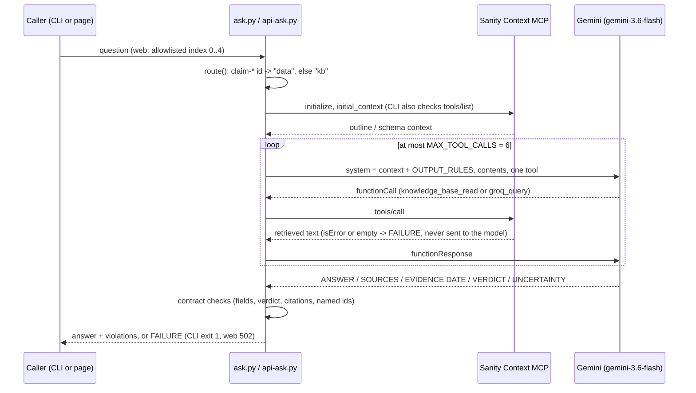
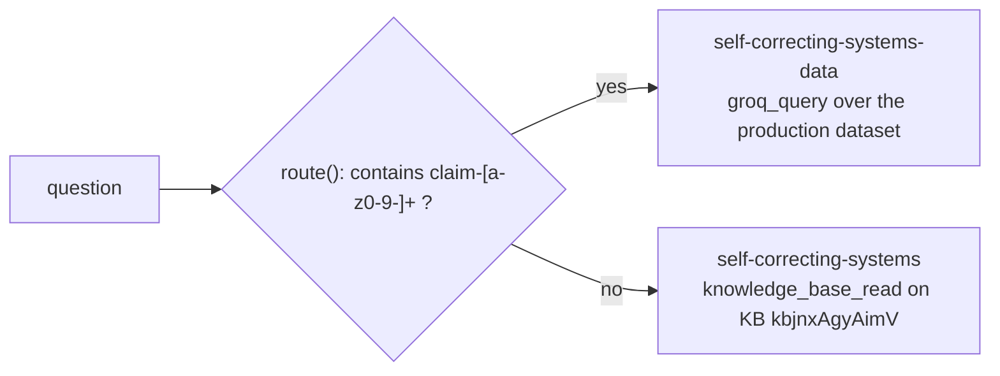

# Architecture

Ask the record answers a question about a public Sanity record from retrieved evidence, or says it
cannot (`VERDICT: INSUFFICIENT_EVIDENCE`). There are two copies of the same loop:

| Path | What it is | Who runs it |
| --- | --- | --- |
| `harness/ask.py` | The graded CLI, built to the frozen `harness/CONTRACT.md` | A person with a Sanity Context token and a Gemini key |
| `web/api-ask.py` | The serverless function behind https://ask-the-record.vercel.app, served as `api/ask.py` (see `web/vercel.json`) | Anonymous visitors, through `web/index.html` |

Both are single-file, standard-library Python. The two copies are not shared modules. The web
docstring says it applies "the same checks the graded CLI harness applies", so a change to one
usually needs the same change in the other.

## Request flow

## Two instruments, one per question

A Context endpoint that has a dataset source serves GROQ mode and ignores Knowledge Base
sources. That is why there are two endpoints (README, "Two instruments"). Routing is amendment
A19 in `harness/CONTRACT.md`.

## What the validator enforces

The same checks appear in `ask()` in `harness/ask.py` and in `contract_violations()` in
`web/api-ask.py`:

- all five labels present, `UNCERTAINTY` non-empty
- exactly one `VERDICT` line, with a value from `VERDICTS`. A value that does not parse is a
  violation and never exempts the answer from the checks below.
- an evidence-bearing verdict (anything other than `INSUFFICIENT_EVIDENCE`) needs at least one read
- dataset answers must cite an http(s) URL. KB answers must cite an entry path and the KB id.
- every `claim-*`, `A<n>` or `B<n>` named in the question must appear in the retrieved text and
  in the answer

It does not resolve URLs or re-verify returned values field by field (README, "Three schema
choices").

## Failure policy

Transport errors, JSON-RPC errors, `isError` tool results, empty retrievals, missing credentials
and missing endpoint tools all raise `Failure`. Retries are bounded: CLI 4 attempts with a 180s
timeout, web 3 attempts with a 60s timeout. Exhausted retries are still a `Failure`, never a
model-written answer. If the model exceeds the 6-call budget, the result is a synthetic
`INSUFFICIENT_EVIDENCE` answer.

## The record

`studio/` is the Sanity Studio schema (`person`, `article`, `finding`, `patch`, `claim`) for
project `u58x3mt0`, dataset `production`. The dataset is publicly queryable at
`https://u58x3mt0.api.sanity.io/v2025-08-15/data/query/production?query=...`. The agent itself
reads through the Context MCP endpoints, which need `SANITY_CONTEXT_TOKEN`.

## Evidence

`evidence/` holds graded runs, breaker verdicts and transcripts, each with a frozen copy of the
`ask.py` it graded. Those files are historical records and are never edited.
